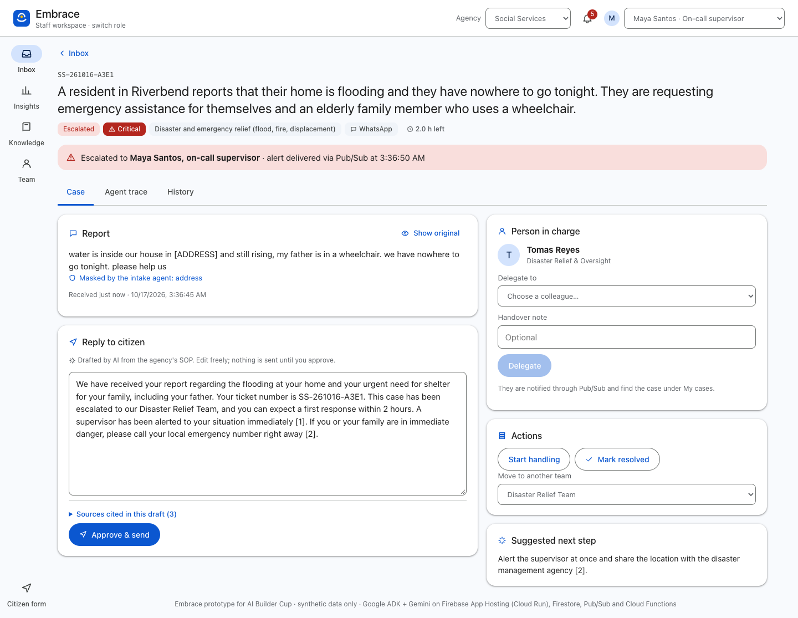

# Embrace

**The AI front door for any social services complaint.** Embrace reads every report a social services office receives (social aid, disability and elderly care, homelessness, disaster relief, violence and child protection) from the web, WhatsApp, email, social media, voice notes or photos. It masks personal data, judges urgency, applies the agency's own escalation rules, assigns a person in charge, finds the right procedure in the agency's SOPs and drafts a cited reply in the citizen's language. A caseworker approves every reply. Leaders get a live dashboard, an AI weekly brief and early warnings when reports cluster around one village, school or payment batch.

Built for the **AI Builder Cup 2026, Social Good track** ("Build in JAPAC. Build for the world.") by team **Nalaria**.

- Live prototype: https://embrace.nalaria.ai.id (also https://embrace--embrace-23a9c.asia-southeast1.hosted.app)
- Demo video: [Google Drive](https://drive.google.com/drive/folders/1vu12gJthTznQft9KAmY7A5rueKGBmqYE?usp=sharing)
- Telegram bots: [@embrace_dinsos_demak_bot](https://t.me/embrace_dinsos_demak_bot) (Demak Social Affairs) and [@embrace_kpai_bot](https://t.me/embrace_kpai_bot) (KPAI)

> Prototype with synthetic data only. The two demo agencies, the Demak Regency Social Affairs Office (Dinsos P2PA Kabupaten Demak) and the Indonesian Child Protection Commission (KPAI), use their real unit structure, published service flows and public regulations; staff names and complaints are fictional, and neither agency endorses this prototype. Demo complaints and documents are in English so anyone can follow them; the agents read Indonesian and Javanese too (see the eval set and the labelled Indonesian samples on the report form), and the Indonesian originals of the service flows are kept next to the translations.

## The problem

Social services desks get every kind of message in one inbox: a family without shelter tonight next to a question about office hours. Staff sort by hand, escalation depends on who reads the message first, replies quote procedures from memory, and no one sees that five families from the same village reported the same missing payment this week. Indonesia's national complaint channel SP4N-LAPOR! has handled 1.18 million reports, about 454 a day ([KemenPANRB via IDN Times, 2026](https://www.idntimes.com/news/indonesia/kemenpan-rb-aduan-sp4nlapor-02-5kbmp-d70p98)), and the child protection commission KPAI recorded 2,031 child-rights violations from 1,508 public complaints in 2025 ([KPAI year-end report](https://www.kpai.go.id/files/2026/01/siaran-pers-laporan-akhir-tahun-KPAI-2025.pdf)). Worldwide, up to 1 billion children aged 2–17 experience violence each year and fewer than 1 in 10 receive help ([WHO](https://www.who.int/news-room/fact-sheets/detail/violence-against-children)), and 3.8 billion people have no social protection at all ([ILO World Social Protection Report 2024–26](https://www.ilo.org/publications/world-social-protection-report-2024-26-universal-social-protection-climate)).

Systems that work today start after a human has read, sorted and typed the case in: UNICEF's Primero (CPIMS+, GBVIMS+) manages child protection and GBV cases in 75 countries, and SP4N-LAPOR! routes complaints to agencies. Embrace is the AI front door before that step.

## What it does

| Step | Agent | What happens |
|---|---|---|
| 0 | Media agent (Gemini) | Transcribes voice notes word for word in any language and describes photos (ID cards, letters, injuries); masks personal data. Runs only when files are attached. |
| 1 | Intake agent (Gemini) | Detects the language, extracts place / institution / programme / age, masks names, phone and ID numbers, restates the complaint in English. |
| 2 | Triage agent (Gemini) | Category from the agency's taxonomy, urgency with the decisive quote, sentiment, safety flags, confidence. |
| 3 | Policy rules (code) | Deterministic escalation and routing. Safety flags, always-escalate categories and keywords force escalation even if the model under-rates the case; model failure falls back to keyword rules and manual review, never silence. |
| 4 | SOP lookup (code) | BM25 search over the agency's SOP documents; no AI tokens. |
| 5 | Reply drafter (Gemini) | Reply in the citizen's language with ticket number, team, response time in hours, and only procedures from the SOP passages, cited [1], [2]. Waits for caseworker approval. |
| – | Analyst agent (Gemini + tools) | Answers leaders' questions and writes the weekly brief by calling tools over live Firestore data (`get_overview`, `find_clusters`, `search_tickets`). |



**Telegram chat channel.** Each agency has its own bot ([@embrace_dinsos_demak_bot](https://t.me/embrace_dinsos_demak_bot), [@embrace_kpai_bot](https://t.me/embrace_kpai_bot)); an agency created in the app connects its bot by pasting the token from @BotFather on its **Channels** page, and Embrace sets the webhook, commands and description. Built-in bots' tokens live in Secret Manager; connected tokens are stored server-side in Firestore. Citizens can chat instead of using the web form. An open chat must not call Gemini on every message, so the webhook (`lib/bot.ts`) handles everything it can in plain code first: it verifies Telegram's secret header and deduplicates updates; answers `/start`, `/new`, `/track`, `/emergency` and greetings; ignores stickers; sends the emergency number at once when danger words appear; adds messages within 24 hours of a report to that case (notifying the person in charge) instead of running the AI again; and enforces Firestore-backed limits per chat (15 messages a minute, 3 new reports an hour, 10 a day) and a global daily AI budget, past which cases are routed by rules and sent to manual review. Real reports are queued on Pub/Sub (`telegram-reports`) so the webhook returns at once; a push subscription runs the ADK pipeline, tells the citizen the report number, team and response time, and the officer's approved reply is sent back to the chat.

Every case gets a **person in charge** (PIC): the policy step assigns the caseworker who owns the queue, and caseworkers can delegate a case to a colleague with a handover note. Escalations and assignments are published to **Pub/Sub** (topic `case-events`); a **Cloud Function for Firebase** (`functions/src/index.ts`) writes a notification for the supervisor and the PIC and marks the alert delivered.

The app opens on a main menu of agency cards (or create a new one). Each agency has its own home at `/a/<id>`: ways for citizens to get help (web form, its Telegram bot, track a report) and the staff workspace by role (caseworker, duty supervisor, head of office). An EN/ID switch in the top bar translates the interface (cookie `lang`, strings in `lib/i18n-id.ts`); agency emblems are public-domain files from Wikimedia Commons (Seal of Demak Regency, Logo Komisi Perlindungan Anak Indonesia), shown with a not-an-official-service note. Each staff role sees its own menu: caseworkers get Inbox (My cases, My team) and Knowledge; the duty supervisor gets the escalation inbox, Team and Knowledge; the head of office gets Insights, a read-only Inbox, Team and Knowledge. Switching account in the top bar switches the menu. It has two sides, in a Material 3 light theme. **Citizens** use `/report` (write, record a voice note or add a photo, in any language; the confirmation shows plain-language progress, with a "staff view" of the agent trace for the demo) and `/track/<id>` (status and the approved reply, no internal data). **Staff** use the workspace under `/staff` with a navigation rail: **Inbox** (My cases, escalated, queues, search), **Case** pages with tabs for the case, the agent trace and the history (delegate to a colleague, approve the reply, reassign, resolve), **Insights** (KPIs, AI weekly brief, early-warning clusters, and an Ask-the-analyst tab), **Knowledge** (the agency's SOP documents and search) and **Team** (who handles what, open cases per person). A demo sign-in picker switches between team members; a bell shows Pub/Sub notifications.

## Built for the world: agency packs

Each built-in agency is a folder under [`agencies/`](agencies/): `agency.json` (categories, queues, team, escalation rules, SLA hours, emergency line, signature), `sop/` (its own SOPs, service flows and regulations with a `sources.json`) and `seed.json` (synthetic demo history). Any other agency is created in the app at `/agencies/new`: start from a copy of a built-in agency, edit categories, teams, staff and escalation words, upload PDFs or Markdown, and it is stored in Firestore and live on the web form, the Telegram bot and the staff workspace at once. No code changes per agency.

| Pack | What it shows |
|---|---|
| `dinsos_demak` | **Demak Regency Social Affairs Office (Dinsos P2PA Demak)**, a district office: UPTD PPA, social protection and security (PKH, BPNT/Sembako), SLRT / Puskesos (DTSEN, PBI/UHC), social rehabilitation, disaster victim protection (tidal floods in Sayung), child marriage and adoption, distribution oversight. Knowledge: its 13 published service flows (English translation and Indonesian original), PermenPANRB 5/2025, Permensos 1/2018 and 4/2023, an example UPTD PPA standard. Demo complaints in English. |
| `kpai` | **Indonesian Child Protection Commission (KPAI)**, a national commission: complaints unit and clusters (special protection, family and alternative care, education, health and welfare). Knowledge: KPAI's complaint SOP (in person, online, assessment, oversight, monitoring, closing cases; English and Indonesian), UU 35/2014, Perpres 61/2016, PermenPANRB 5/2025, UN CRC. |

Why these two: the team is in contact with people at both agencies, and they cover the two ends of social complaints, a district office that delivers services and a national commission that refers and oversees.

Prospective users are social affairs offices and child protection commissions, starting with the two above; Embrace is a blueprint each agency deploys in its own Firebase project, so complaint data stays with the agency.

## How it uses Google Cloud

- **Gemini** (Gemini API, `gemini-3.1-flash-lite` for media, intake, drafting and analysis; `gemini-2.5-flash` for triage) for multilingual understanding, audio transcription, image reading, structured outputs and tool calling.
- **Google Agent Development Kit (ADK) for TypeScript**: the pipeline is an ADK `SequentialAgent` of four `LlmAgent`s with Zod output schemas plus two custom `BaseAgent`s (rules and SOP search); the analyst is an `LlmAgent` with `FunctionTool`s.
- **Firebase App Hosting**: builds and serves the Next.js app (UI + API route handlers) from this repo; secrets come from Secret Manager.
- **Cloud Run**: App Hosting runs the Next.js server on Cloud Run (`asia-southeast1`, one warm instance during judging); agent progress streams to the browser over Server-Sent Events.
- **Pub/Sub + Cloud Functions for Firebase**: escalations, assignments and citizen follow-ups are published to the `case-events` topic; the `onCaseEvent` function notifies the supervisor and the person in charge and marks alerts delivered. Telegram reports are queued on `telegram-reports` and pushed to the app, so the webhook answers Telegram instantly.
- **Cloud Firestore**: cases with the full agent trace, person in charge, history and caseworker actions, plus `notifications`; the analyst agent's tools read it live. Security rules deny all client access; only the server and the function write.
- **Firebase Analytics**: page and screen usage of the prototype.

## Quality

Triage eval on 60 labelled synthetic complaints (Indonesian, Javanese, English; 30 for KPAI, 30 for Dinsos Demak), `npm run eval`, results in [`data/eval/results.json`](data/eval/results.json):

| Metric | Result |
|---|---|
| Category accuracy | 93% |
| Urgency exact / within one level | 78% / 100% |
| Critical cases escalated (9 cases), model alone and with rules | 100% / 100% |
| Escalations that were truly high or critical (24) | 92% |
| Sent to manual review | 0% |

Remaining misses are borderline: a shared bullying video and two school beatings read as violence rather than online harm or education, and an office-hours question read as registration.
In local test runs a text complaint went through all five steps in about 6 seconds.

**Load test on production**: ~290 page views/s with 50 concurrent users (p99 287 ms, 0 errors) on one warm Cloud Run instance; case list API 63 req/s (p50 277 ms); 10 AI reports at once all completed in about 4.7 s each, first progress event within 0.23 s (`scripts/load-burst.mjs`).

**Agency pages, channels and settings.** Every agency has a public page (`/a/<id>`) with its channels, emergency line, what it handles and the documents its replies follow. The head of office edits the agency under **Settings**: SLA hours per urgency, which AI safety signals force escalation, escalation words, the confidence threshold for manual review, per category the team, always-escalate and a minimum urgency, the staff, and the documents (PDF/Markdown upload). Built-in agencies keep the edits as an override; **Reset demo data** restores them. Two things are fixed for every agency: escalation is decided by rules, and a person approves every reply.

**Document search.** The demo uses BM25 (no model tokens, works offline, explainable). Next: hybrid search, BM25 plus Gemini embeddings, for questions phrased far from the documents' wording.

## Run it

Requirements: Node 22+, a Gemini API key.

```bash
npm install
cp .env.example .env.local     # set GOOGLE_GENAI_API_KEY
npm run dev                    # http://localhost:3000, in-memory store
npm test                       # policy rules, SOP search and Telegram gatekeeping, no model calls
npm run eval                   # triage eval, uses the Gemini key
npm run sop:index              # rebuild agencies/*/sop-index.json after changing SOP documents
```

Deploy to your own Firebase project (Blaze plan; stays within free tiers at prototype volume):

```bash
firebase use <project-id>
gcloud firestore databases create --location=asia-southeast1 --project <project-id>
firebase apphosting:backends:create --backend embrace --primary-region asia-southeast1
firebase apphosting:secrets:set gemini-api-key        # paste the Gemini API key
firebase apphosting:secrets:grantaccess gemini-api-key --backend embrace
firebase deploy --only apphosting,firestore,functions
```

## Layout

```
app/              Next.js App Router: page + API route handlers (app/api/*)
functions/        Cloud Function for Firebase: Pub/Sub case events -> notifications
components/       React UI (Report, staff workspace, Insights)
lib/agents/       ADK agents: pipeline.ts, analyst.ts, models.ts
lib/              policy rules, SOP search, Firestore store, analytics, seeding
agencies/<id>/    agency packs: agency.json, sop/, sop-index.json, seed.json
scripts/          SOP index builder, triage eval
tests/            vitest: policy and SOP search
```

## Safety and privacy

- Synthetic data only. Personal data is masked by the intake agent before staff see it; the original stays behind a "Show original" toggle.
- Escalation never depends on the model alone; replies are never sent without caseworker approval.
- Attachments are sent to Gemini and not stored; the ticket keeps only their type and size and what the media agent read.
- Per-IP rate limits protect the demo's Gemini budget.

## License

All rights reserved: the code is public for review, not open source (see [LICENSE](LICENSE)). Third-party documents, emblems, icons and dependencies keep their own terms, listed in [NOTICE.md](NOTICE.md).
